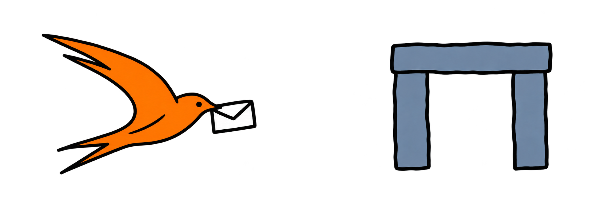

<div align="center">

# WayGate

A Swift library for Minecraft: Bedrock Edition networking.

[](https://www.swift.org)



</div>

## Overview

WayGate provides packet codecs and game sessions over [NetherNet](https://github.com/bedrock-swift/nethernet) and [RakNet](https://github.com/bedrock-swift/raknet). Use it to build Bedrock servers, proxies, and other networking tools.

## Getting started

Add WayGate to your Swift package and use the `WayGate` product. Swift 6.1 or later is required.

```swift
.package(url: "https://github.com/bedrock-swift/waygate.git", branch: "main")
```

Use `BedrockLoginServer.multiplayer(keys:)` with `MinecraftLoginKeys` for the Bedrock 26.60 protocol. Pass an authenticated NetherNet connection to `login.accept(on:)` to open a game session. The [NetherNet README](https://github.com/bedrock-swift/nethernet#http-signaling) covers the HTTP signaling setup.

### RakNet relay

The demo listens on loopback and relays RakNet packets to a fixed upstream.

```sh
swift run waygate 19142 127.0.0.1 19132
```

## Development

```sh
swift test
```

See [Contributing](.github/CONTRIBUTING.md).
